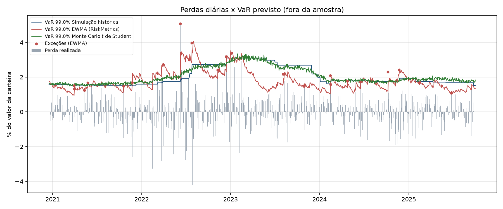

# Backtesting de VaR e Expected Shortfall

Comparação de cinco modelos de Value at Risk (VaR) e Expected Shortfall (ES) para uma carteira de ações da B3, com backtesting fora da amostra em janela móvel e testes estatísticos de cobertura.

## Pergunta que o projeto responde

Qual modelo de risco de mercado estima corretamente a perda extrema diária de uma carteira, e por que modelos baseados na distribuição normal subestimam o risco em mercados com caudas pesadas e volatilidade variável?

## Modelos implementados

| Modelo | Ideia | Limitação principal |
|---|---|---|
| Simulação histórica | Quantil empírico das perdas dos últimos 250 dias | Reage devagar a mudanças de regime |
| Paramétrico normal | VaR = -μ + σ·z<sub>α</sub> | Ignora caudas pesadas |
| EWMA (RiskMetrics, λ = 0,94) | Volatilidade com peso maior para dados recentes | Mantém hipótese normal |
| Monte Carlo normal | Simulação da normal multivariada dos ativos (Cholesky da covariância) | Mesma hipótese normal |
| Monte Carlo t de Student | t multivariada com 5 graus de liberdade e mesma covariância | Graus de liberdade fixos |

## Metodologia

1. **Dados:** retornos simples diários (o retorno da carteira é a soma ponderada exata dos retornos dos ativos).
2. **Backtest sem viés de antecipação:** para cada dia t, os modelos são estimados apenas com os 250 dias anteriores e a previsão é comparada com a perda realizada em t.
3. **Testes estatísticos:**
   - **Kupiec (POF):** a proporção de exceções é compatível com 1 - α?
   - **Christoffersen (independência):** as exceções aparecem agrupadas?
   - **Cobertura condicional:** combinação dos dois (qui-quadrado com 2 graus de liberdade).
   - **Semáforo de Basileia** para VaR 99% nos últimos 250 dias.

## Resultados (dados reais da B3)

Carteira com pesos iguais (25% cada) em PETR4, VALE3, ITUB4 e BOVA11, preços ajustados do Yahoo Finance de 02/01/2019 a 02/10/2026 (1.929 retornos diários). Período fora da amostra: 07/01/2020 a 02/10/2026, 1.679 dias. VaR 99%, exceções esperadas: 1.679 × 1% = 16,79.

| Modelo | Exceções | Taxa | p-valor Kupiec | p-valor Christoffersen (ind.) | p-valor cobertura condicional | VaR médio | ES médio | Basileia (últimos 250 dias) |
|---|---|---|---|---|---|---|---|---|
| Simulação histórica | 25 | 1,49% | 0,060 | **0,005** | **0,003** | 4,03% | 5,28% | verde (4) |
| Paramétrico normal | 28 | 1,67% | **0,012** | **0,010** | **0,002** | 3,42% | 3,93% | amarelo (6) |
| EWMA (RiskMetrics) | 24 | 1,43% | 0,097 | 0,404 | 0,178 | 3,24% | 3,71% | verde (2) |
| Monte Carlo normal | 29 | 1,73% | **0,007** | **0,013** | **0,001** | 3,42% | 3,93% | amarelo (7) |
| Monte Carlo t de Student | 20 | 1,19% | 0,445 | **0,001** | **0,004** | 3,84% | 5,11% | verde (2) |

Em negrito: p-valor abaixo de 0,05 (modelo rejeitado naquele teste ao nível de 5%). Entre parênteses na última coluna, o número de exceções nos últimos 250 dias.


**Conclusão:**

- **Todos os modelos tiveram mais exceções do que as 16,79 esperadas**, de 20 (Monte Carlo t) a 29 (Monte Carlo normal).
- **Os dois modelos normais com volatilidade constante na janela são rejeitados nos três testes**: paramétrico normal (28 exceções, Kupiec 0,012) e Monte Carlo normal (29 exceções, Kupiec 0,007). São também os únicos na zona amarela de Basileia.
- **O Monte Carlo t tem a contagem de exceções mais próxima da esperada** (20; Kupiec 0,445), mas é rejeitado no teste de independência (0,001): 8 das suas 20 exceções ocorreram em fevereiro e março de 2020, e 3 em dias seguidos a outra exceção. Caudas pesadas corrigem o nível do VaR, mas não a velocidade de reação.
- **A simulação histórica não é rejeitada por Kupiec, por margem estreita** (25 exceções; 0,060), e é rejeitada em independência (0,005) pelo mesmo motivo: 7 das 25 exceções em fevereiro e março de 2020.
- **O EWMA é o único modelo não rejeitado nos três testes** (Kupiec 0,097; independência 0,404; cobertura condicional 0,178). Teve 3 exceções em fevereiro e março de 2020 e nenhuma em dias consecutivos, mesmo com o menor VaR médio da comparação (3,24%). Ainda assim, ficou com 24 exceções contra 16,79 esperadas: a hipótese normal continua subestimando a cauda, só que não o bastante para rejeição a 5% nesta amostra.
- **Diferença em relação aos dados sintéticos:** lá, o problema dominante eram as caudas pesadas e o Monte Carlo t vencia. Nos dados reais, o que mais derruba os modelos é o agrupamento de volatilidade (choque da Covid em 2020), e vence quem atualiza a volatilidade rapidamente.
- **Expected Shortfall:** nos modelos normais o ES médio fica cerca de 15% acima do VaR médio (3,93% contra 3,42%); na simulação histórica e no Monte Carlo t, cerca de 31% a 33% acima (5,28% contra 4,03%; 5,11% contra 3,84%). A normal subestima o tamanho da perda depois que o VaR é rompido.

**Limitações dos dados:**

- A queda de 17,96% de ITUB4 em 04/10/2021 coincide com a cisão da participação do Itaú na XP, que o preço ajustado do Yahoo Finance (ajustado por dividendos e desdobramentos) não compensa. Esse dia gera perda de 4,55% na carteira e é contado como exceção nos cinco modelos. Os dados foram mantidos como vieram da fonte.
- Preços ajustados do Yahoo Finance são recalculados a cada novo provento, então uma nova execução pode produzir números ligeiramente diferentes.

## Validação com dados sintéticos

Antes dos dados reais, o código foi validado em retornos simulados com GARCH(1,1) e inovações t de Student (5 graus de liberdade), em que a resposta esperada é conhecida: modelos normais devem falhar. Período fora da amostra de 1.250 dias, VaR 99%, exceções esperadas: 1.250 × 1% = 12,5.

| Modelo | Exceções | Taxa | p-valor Kupiec | Resultado |
|---|---|---|---|---|
| Simulação histórica | 16 | 1,28% | 0,340 | Não rejeitado |
| Paramétrico normal | 26 | 2,08% | 0,001 | **Rejeitado** |
| EWMA | 22 | 1,76% | 0,015 | **Rejeitado** |
| Monte Carlo normal | 26 | 2,08% | 0,001 | **Rejeitado** |
| Monte Carlo t de Student | 14 | 1,12% | 0,676 | Não rejeitado |

Os três modelos com hipótese normal produzem de 1,8 a 2,1 vezes as exceções esperadas e são rejeitados pelo teste de Kupiec. Modelar caudas pesadas (Monte Carlo t) corrige o problema.



## Como rodar

```bash
pip install -r requirements.txt
python -m pytest -q                      # validação numérica
python run.py --synthetic                # sem internet
python run.py --tickers PETR4.SA VALE3.SA ITUB4.SA BOVA11.SA --start 2019-01-01 --end 2026-10-05
python run.py --tickers PETR4.SA VALE3.SA --weights 0.6 0.4 --alpha 0.975
```

O `--end` é exclusivo: `2026-10-05` faz a série terminar no pregão de 02/10/2026 e reproduz a tabela acima. Sem `--end`, a série vai até o último dado disponível, o que pode incluir um pregão ainda em andamento.

Saídas em `results/` (dados reais) e `results/sintetico/` (`--synthetic`): previsões diárias (CSV), resumo por modelo (CSV), gráfico e relatório em Markdown.

## Validação numérica

Os testes em `tests/` comparam a implementação com valores calculados à mão, por exemplo:

- VaR normal 99% com σ = 1%: 0,01 × 2,326348 = **2,326%**; ES = 0,01 × φ(2,326348) / 0,01 = **2,665%**.
- Kupiec com 10 exceções em 250 dias (p = 1%): LR = -2(-48,4638) + 2(-41,9860) = **12,955** (p-valor < 0,001).
- Monte Carlo normal converge para o VaR paramétrico (erro relativo < 1%).
- Christoffersen detecta exceções agrupadas e aceita exceções espaçadas.

## Estrutura

```
src/data.py          carregamento (Yahoo Finance) e gerador sintético GARCH-t
src/risk_models.py   VaR e ES: histórico, normal, EWMA, Monte Carlo normal e t
src/backtest.py      janela móvel, Kupiec, Christoffersen, semáforo de Basileia
run.py               execução, gráfico e relatório
tests/               testes de validação numérica
```

## Referências

- Kupiec, P. (1995). Techniques for Verifying the Accuracy of Risk Measurement Models.
- Christoffersen, P. (1998). Evaluating Interval Forecasts.
- J.P. Morgan (1996). RiskMetrics Technical Document.
- Basel Committee (1996). Supervisory Framework for the Use of Backtesting.
