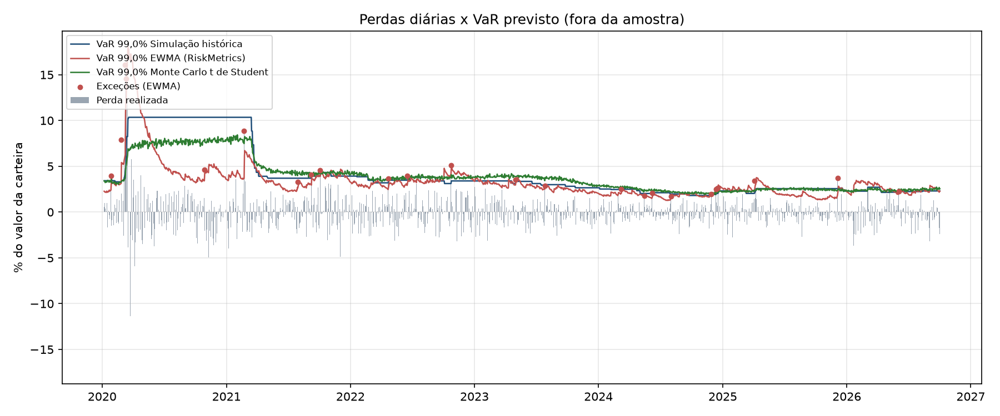

# Relatório de backtest de VaR

- Fonte: Yahoo Finance
- Ativos: 4 | Pesos: 25,00%; 25,00%; 25,00%; 25,00%
- Período fora da amostra: 07/01/2020 a 02/10/2026
- Nível de confiança: 99,0% | Janela de estimação: 250 dias | Simulações Monte Carlo: 10.000

| Modelo | Exceções | Esperado | Taxa | p-valor Kupiec | p-valor Christoffersen (ind.) | p-valor cobertura condicional | VaR médio | ES médio |
|---|---|---|---|---|---|---|---|---|
| Simulação histórica | 25 | 16,79 | 1,49% | 0,060 | 0,005 | 0,003 | 4,03% | 5,28% |
| Paramétrico normal | 28 | 16,79 | 1,67% | 0,012 | 0,010 | 0,002 | 3,42% | 3,93% |
| EWMA (RiskMetrics) | 24 | 16,79 | 1,43% | 0,097 | 0,404 | 0,178 | 3,24% | 3,71% |
| Monte Carlo normal | 29 | 16,79 | 1,73% | 0,007 | 0,013 | 0,001 | 3,42% | 3,93% |
| Monte Carlo t de Student | 20 | 16,79 | 1,19% | 0,445 | 0,001 | 0,004 | 3,84% | 5,11% |

**Leitura:** p-valor abaixo de 0,05 rejeita o modelo ao nível de 5%. Kupiec testa se a quantidade de exceções está correta; Christoffersen testa se as exceções aparecem agrupadas (sinal de que o modelo não acompanha a volatilidade).

**Semáforo de Basileia (últimos 250 dias, VaR 99%):** Simulação histórica: verde; Paramétrico normal: amarelo; EWMA (RiskMetrics): verde; Monte Carlo normal: amarelo; Monte Carlo t de Student: verde

